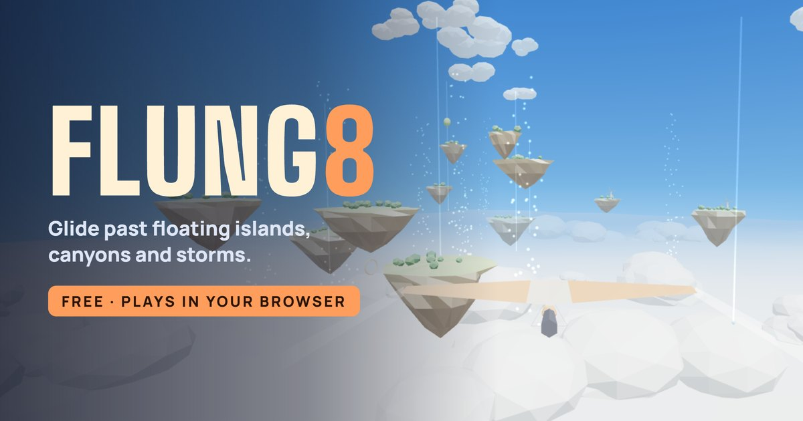

# Flung8

A 3D glider game that runs in your browser. It's free, and there's nothing to install or sign up for.

Play it here: https://phel433.github.io/flung8/

The glider has no engine. You dive to pick up speed and spend it when you climb, so most of the game is deciding when to trade height for speed. There are 7 worlds to fly through, with ring courses, Sky Shards to find, live races, and an Open Sky mode where up to 8 people fly together.

## Modes

Each world has two ring courses: an easy Line and a hard Gauntlet. That makes 14 in total, and each one has bronze, silver, gold and platinum medal times.

Endless keeps adding rings until you crash or miss one. Score Attack gives you two minutes on a ring field that changes every run.

In Explore you look for the 20 Sky Shards hidden in each world. Find all 20 and Gem Rush opens, where every shard you grab turns up somewhere else.

Open Sky and Race are the online modes.

## Controls

| Key | Action |
|---|---|
| W / S | Dive / climb, hold to loop |
| A / D | Turn left / right |
| ← / → or Q / E | Barrel roll |
| Space | Boost |
| Shift | Air brake |
| T | Switch steering style |
| C | Change camera |
| R | Back to the last ring |
| P | Photo mode |
| Esc | Pause |

On phones and tablets you get buttons on the screen. Gamepads work too.

The full guide is on the [How to play](https://phel433.github.io/flung8/how-to-play.html) page.

## How it's built

Plain JavaScript and [three.js](https://threejs.org/) r128. The live server for Open Sky and races is in `server/`, written in Node.js with the `ws` package.
